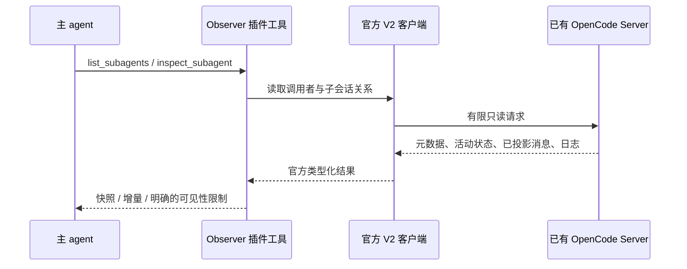

# 实现方案

状态：已按此方案实现首版；实际联调差异见 compatibility.md 与 testing.md。核查日期：2026-10-19。

## 1. 目标与边界

为 OpenCode V2 提供一个独立插件，让主 agent 主动查询它派出的子 agent。
获取的信息可用于进度汇报、工作协调、阻塞判断和结果检查，插件不绑定具体业务流程。

必须满足：

1. 子 agent 无感：观察不进入其上下文，不要求它调用汇报工具，也不改变执行方式。
2. 主 agent 主动查询：插件只有收到工具调用才读取目标数据。
3. 纯 pull：没有持续订阅、后台采集、定时器、自动唤醒或主动注入消息。
4. 保持源码不变：只使用官方插件扩展点和公开客户端 API。
5. 尽量复用组件：不建立第二套会话存储、事件总线或 agent 执行框架。

主 agent 可以自行重复调用查询工具。它结束响应后，插件不会自动让它恢复执行。
想在子 agent 工作期间查询，应以 OpenCode 已有的后台子任务方式启动；插件不负责启动子任务。

“无感”限定为查询对子 agent 的消息、上下文和执行控制没有写入。
查询本身仍然会消耗服务端读取资源，并作为主 agent 的工具调用出现在主会话中。

## 2. 推荐架构



查询期间子 agent 照常执行。Observer 不调用目标会话的 prompt、synthetic、generate、wait、interrupt 或 update。

插件只包含三部分：工具注册与提示适配、官方客户端接入、查询结果整形。
初期保持单个包和少量模块，不搭建 HTTP 服务、MCP 服务、数据库或通用 agent 框架。

## 3. 技术选型：先复用，再补必要逻辑

| 责任 | 采用 | 自己需要编写的部分 |
| --- | --- | --- |
| 插件生命周期、工具注册 | `@opencode/plugin` 的 Promise API | `Plugin.define` 与 `ctx.tool.transform` 注册 |
| 读取服务端数据 | `@opencode/client` 生成客户端 | 调用顺序、字段选择、取消与输出上限 |
| 服务发现与认证 | `@opencode/client/service` | 选择本地发现或显式地址，验证连接目标 |
| 输入与插件配置校验 | Zod 4 / Standard Schema | 本插件输入字段，不重写 OpenCode 类型 |
| OpenCode 数据类型 | 官方客户端导出的生成类型 | 仅定义精简的观察结果 DTO |
| 运行、安装、打包、测试 | Bun 原生能力 | 必要的构建配置和行为测试 |
| 源码与模块 | TypeScript、ESM、async/await | 查询逻辑 |

采用 Zod 是因为 OpenCode 工具接受 Standard Schema，且基线已经依赖 Zod 4。
不为这个只读插件自行引入 Effect 应用层；SDK 的传递依赖和宿主要求仍需遵守。
不同时使用多个 Schema 库重复校验，不自行拼接 fetch 请求或解析 SSE。

“现代主流”在这里指类型化官方 SDK、标准 Schema、ESM 和轻量插件组合。
不会为了选型新颖而引入 LangChain、LangGraph、NestJS、队列或独立观测平台；本需求没有对应职责。

## 4. 接入现有 OpenCode 服务

最初核查源码为 V2 `2.0.23`，实际安装并用于联调的宿主为 `2.0.32`。插件上下文与完整客户端的能力并不相同。
例如，`ctx.session` 有 get/context，但没有 list/active/log，也没有完整消息分页能力。
不能假设文档中的所有 Session 方法都存在于当前宿主上下文。

连接策略：

1. 本地托管服务：查询开始时通过官方 `Service.discover()` 发现健康的已有服务，不设精确版本门禁。
2. 使用 `Service.headers(endpoint)` 生成认证头，交给 `OpenCode.make()`。
3. 自定义或远程服务：从插件 options 获取显式 baseUrl 与认证配置，仍使用官方客户端。
4. 用客户端读取调用者会话，并与 `ctx.session.get()` 得到的调用者身份和位置进行核对。
5. 首次联调验证宿主与客户端连接目标一致；不能确认时返回配置错误，不猜测其他端口。

只使用 discover，不使用 ensure/stop；观察插件不得启动、替换或停止 OpenCode 服务。
服务发现涉及的协议检查由官方库完成，不自行读取或解释私有凭证文件。
连接句柄可以按插件生命周期复用，业务状态每次查询重新获取，不维护后台状态缓存。

官方包实际导出与宿主行为通过真实联调验证；依赖锁定用于复现，不限制宿主补丁版本。详见 [兼容性记录](compatibility.md)。

## 5. 工具契约

以下名称和字段是拟定契约，编码时以类型验证和真实交互结果为准。
两项工具均直接返回结构化观察数据及简短可读文本，不额外调用模型生成摘要。

### 5.1 `list_subagents`

列出调用者的直接子会话，帮助主 agent 发现可查询对象。

输入：`limit`、可选 `cursor`。调用者 sessionID 只从工具执行上下文获取，不能让模型指定其他 parentID。

输出：子会话 ID、标题、agent/model、活动状态、上次执行 outcome、更新时间，以及分页 cursor。
首版返回服务端保存的标题作为短任务标签，不额外扫描父会话完整历史，不编造任务描述。

服务端按 parentID 过滤，复用官方分页；不默认遍历所有会话。
OpenCode 的 fork 也可能有 parentID，必须检查 fork 字段并区分，不能将所有子会话当成派出的 subagent。
分页时继续在插件侧绑定调用者 parentID，不能直接信任客户端传来的不透明 cursor 范围。
若过滤掉 fork，不伪造剩余数量或“已经没有下一页”；沿用实际读取到的分页位置。
首版只支持直接子会话；递归子孙观察可以后续另加明确选项。

### 5.2 `inspect_subagent`

输入：

| 字段 | 含义 |
| --- | --- |
| `sessionID` | 被观察的直接子会话 |
| `view` | `snapshot`（默认）或 `changes` |
| `include` | `messages`、`reasoning`、`tools`；按需展开 |
| `limit` | 返回条目数，默认 20，上限 100 |
| `maxChars` | 文本预算，默认 12000，上限 40000 |
| `afterSeq` | changes 模式的持久日志序号；首次省略时从起点有限读取 |
| `cursor` | snapshot 历史页游标，直接复用官方消息分页 |
| `messageID` | snapshot 指定一条消息，复用官方单消息读取 |
| `offset` / `revision` | 消息详情 JSON 文本的续读位置与内容指纹 |

无论哪种 view，都返回当前状态快照。详细过程按 include 选择。
snapshot 默认包括消息、工具与可见 reasoning；所有本页消息和所选片段保留概览，不默认灌入全部历史。
长内容仅裁剪正文预览，不丢掉后面的工具身份与状态；通过 messageID 分段补读。

输出包含：

- 查询开始、结束时间，以及观测来源。
- `execution.active`、`execution.lastOutcome`、`activity.phase`、权限等待信息。
- 选定的消息、工具、推理文本或持久事件条目。
- changes 模式的 `nextAfterSeq`、是否已读到本次同步边界。
- 截断、未知字段、实时片段可见性等信息。

工具结果里直接使用文字标记“子 agent 的输出 / 工具输出”，保留其来源。
不把读取到的任意文本当成新的系统指令，也不擅自将其结论提升为已验证事实。

## 6. 状态模型：返回事实，避免混淆

不要只返回一个含义混杂的 running/completed 字符串。

| 维度 | 数据来源 | 表达方式 |
| --- | --- | --- |
| 当前是否执行 | `client.session.active()` | active / inactive，限当前服务器进程可见的执行 |
| 上次执行结果 | `client.session.get()` 的 outcome/time | succeeded / failed / interrupted / 尚无记录 |
| 当前可见活动 | 最近消息与持久日志 | generating / reasoning / tool_input / tool_running / unknown |
| 是否待授权 | 官方 permission request list | 存在针对该会话的未处理请求 |
| 最近活动时间 | 消息/日志/会话时间 | 明确来源，不将更新时间当作心跳 |

活动会话可能保留上一轮 outcome，因此活动标记与上次结果必须分开。
inactive 不自动等于完成，也可能还没开始、被中断或处于当前进程不可见的执行环境。
一次工具 error 不等于整个子任务 failed；没有新日志也不代表卡死。
读取是多个有限请求，不承诺原子快照；返回查询时间范围，允许下一次轮询看到更新。

运行中的重试原因、非持久工具 progress 元数据不一定能通过纯 pull 精确还原。
官方只读接口没有证据时返回 unknown / unavailable，而不是推断为确定状态。
用户问答等等待类型，在确认对应只读 API 后再增加，首版不冒充已经支持。

## 7. 过程与增量读取

### 快照

通过 `client.message.list()` 读取最近投影消息，以官方 cursor 继续读取较早页。
这比 context 更合适：context 只包含压缩后当前上下文，不能代表完整执行记录。
每次 snapshot 都重新读取最近页，因同一条 assistant 消息及其工具状态可能继续变化。
消息分页游标不能充当内容更新水位；翻历史时单独读取最新页判断当前活动。
正文按片段均分预算，工具 ID、名称、状态和错误摘要保留在概览中。
单条完整可见消息使用 `client.session.message.get()`，按 maxChars 和 offset 返回 JSON 文本片段。
使用 Bun.hash 检查 revision，不自建历史存储；内容改变时要求重读，避免拼接不同版本。

### 增量

使用官方 `client.session.log({ sessionID, after, follow: false })`。
该接口采用 SSE 编码，但 follow=false 是一次有限历史读取；没有持续监听，也不订阅 live stream。
解析和连接关闭交给官方客户端，不手写协议。

以持久事件的 aggregate seq 作为增量水位，支持观察同一消息内部的后续变化。
读取到同步标记或达到输出上限就结束迭代，并关闭迭代器/连接。
输出受限时，只将水位推进到确实消费并处理的事件；保留下一次继续读取的位置。
过滤掉的非展示事件可推进消费水位，但不得跳过尚未处理的匹配事件。
单条大结果被裁剪时保留事件 seq、关联消息标识和 truncated 标志，可再按 messageID 分段补读。

增量日志记录已持久化的过程，不是每个 token 的直播，也不会自动补全消失的临时事件。
日志保留、revert、删除等实际行为须在兼容性阶段验证；水位失效应明确返回需重新取快照。
不为了实现游标额外建数据库或持久缓存。

真实联调补充：当前宿主会返回 log.synced 和序号，但没有返回可重放事件正文。
当序号推进却没有正文时，插件返回 historyUnavailable=true、当前投影 snapshot 和新水位。
保持纯 pull，不自行重建事件日志，也不把无正文解释为“没有进展”。支持事件正文的宿主仍走正常增量路径。
有限日志先读取同步边界，再读取快照，避免提前取到的旧快照遗漏已确认水位对应的新投影。

## 8. 纯 pull 的实时能力边界

源码核查发现：`session.text.delta`、`session.reasoning.delta` 和工具参数 delta 属于临时事件。
对应完整文本在 ended 边界持久化；projector 没有将这些 delta 持续写入消息投影。
工具 progress 也属于独立的 live 信息，不能假设消息查询已保存其所有变化。

因此本方案支持：

- 查询当时的活动状态、已出现的执行阶段和已持久化的工具状态。
- 工具调用参数/结果、阶段结束后的文字和可见 reasoning。
- 持久日志的逐次增量读取。

本方案不承诺：

- 正在生成、尚未结束的那段文字或 reasoning 的最新 token。
- 未暴露的内部推理、隐藏 provider 状态或完整实时重试细节。
- 模型生成期间中途改变主 agent 已发送的请求上下文。

这是“不改源码 + 不订阅任何事件 + 只用公开只读 API”的可见性边界。
不会暗中订阅事件来伪装成纯 pull，也不通过新模型调用让子 agent 解释自己。
首阶段联调需将真实返回样例记录下来，校准各字段的延迟和可用性。

## 9. 内置禁止轮询提示的适配

当前 subagent 的参数描述和后台返回文本均提示主 agent 不要轮询。
新增观察工具而保留这两处提示，会产生直接冲突，不能只改顶层 description。

使用插件公开扩展点完成针对主会话的适配：

1. 在 session context hook 中，仅为拥有观察工具的调用者调整 subagent 的 background 参数说明。
2. 用 tool transform 包装既有 subagent executor；仍委托原 executor 完成执行。
3. 只修改已知 running 后台返回中的禁止查询文字及同义结构化输出，保留 sessionID/status/metadata。
4. 说明允许调用只读观察工具；不改变“避免重复执行子 agent 工作”等原有职责约束。
5. 不修改发往子 agent 的 prompt，也不强制所有任务后台执行。

必须测试工具执行包装在 reload 后不会重复嵌套，且保留原来的取消和错误行为。
适配按实际返回结构识别，不设精确版本门禁；不认识的结构保留原结果，不全局删改任意消息。
这部分是很薄的兼容适配，不复制 OpenCode 的子任务调度实现。

OpenCode 原生的后台完成通知仍由宿主负责；本插件不新增自动通知。
纯 pull 指新增观察能力的工作方式，首版不额外改变宿主原有通知机制。

## 10. 查询范围与错误

调用者身份来自 ToolContext.sessionID，目标必须满足 target.parentID 等于调用者 ID，且不是 fork。
不允许模型通过任意 sessionID 或分页 cursor 绕过这一关系；首版不提供全服务器查询权限。

错误只表达实际情况：未知会话、不是直接子任务、服务未发现、版本不兼容、认证失败、请求取消或超时。
未知状态不是错误；字段不可见应留空并解释来源限制。
传递工具调用 AbortSignal，复用客户端取消机制与原生 AbortSignal.timeout。
不无限重试、不自动启动服务、不调用子 agent 获取“补充信息”。

## 11. 预期目录

```text
opencode-subagent-observer/
  README.md
  AGENTS.md
  package.json
  docs/
    implementation-plan.md
    compatibility.md
  src/                       # 实现阶段创建
    index.ts                 # Plugin.define、工具注册、有限提示适配
    client.ts                # 官方服务发现与客户端连接
    observe.ts               # 两项查询的编排和结果整形
    schema.ts                # 工具/配置 Schema；有足够内容再拆分
  test/                      # 实现阶段创建
  examples/                  # 实现阶段创建本地插件配置
```

不提前拆成 monorepo、多层服务接口、适配器框架或可插拔存储。
只有复用或复杂度真正出现时再拆模块。

## 12. 实施顺序

### 阶段 A：兼容性验证

- 安装与宿主匹配的官方版本，验证 Promise 插件加载、Standard Schema 与工具输出。
- 配置 Bun 工具链、TypeScript 类型检查、Bun.build；锁定依赖并提交 lockfile。
- 验证服务发现和显式连接；只接入已有服务，不触发替换。
- 验证 list/get/active/messages/permission/log(follow=false) 的真实签名与返回值。
- 确认有限日志读取可结束；记录未结束 reasoning 和工具输入能读到什么。
- 验证已有 subagent 工具可通过公开 hook/transform 适配，不修改源码。

### 阶段 B：最小查询能力

- 实现 list_subagents 和 inspect_subagent(snapshot)。
- 实现直接子会话约束、fork 排除、分页、状态事实分离及输出限制。
- 确认查询前后子会话没有新增用户/合成/系统消息，没有查询触发的模型调用。

### 阶段 C：过程与增量

- 基于官方有限日志读取实现 changes / afterSeq。
- 支持 messages/reasoning/tools 按需展开，验证同消息内部更新、截断和恢复读取。
- 完成禁止轮询提示适配与主 agent 使用说明。

### 阶段 D：真实联调与交付

- 在独立测试会话运行后台子任务，由主 agent 主动多次查询。
- 覆盖运行、工具执行、授权等待、失败、完成和继续同一子会话的场景。
- 提供可加载的本地配置、构建产物和版本适配记录，再考虑发布 npm。

实施进度与已验证范围以 testing.md 为准；日志正文缺失的宿主使用上面说明的显式快照退化路径。

## 13. 验证与验收

优先使用 Bun 内置测试，不为低影响文件结构编写形式化测试。
查询逻辑使用官方客户端配合可控 HTTP fixture 或记录过的协议样例验证，不重新实现服务端逻辑。
mock 只用于确定的传输边界；真实 OpenCode 会话联调负责验证 SDK/宿主契约。

必须验证的行为：

1. 主 agent 能发现自己派出的直接子 agent；其他父会话与 fork 不会混入。
2. 对照正在运行的真实子会话，状态、工具参数/结果与可见 reasoning 来源正确。
3. 同一 assistant 消息的后续工具变化不会因消息 ID 没变而漏掉。
4. inactive、lastOutcome 和工具错误互不混淆。
5. changes 水位、截断和下一次读取不会静默丢失持久事件。
6. 连续查询不会向目标会话写入观察消息或触发额外模型执行。
7. 空闲插件没有订阅、定时器或后台查询；有限读取完成后关闭连接。
8. 主 agent 实际收到的 schema 描述与后台工具结果都不再禁止只读查询。
9. 服务版本不匹配、断连、取消时有可操作的错误，不替换已有服务。
10. 超长输出有裁剪标记，且观察工具本身不调用模型总结内容。

实施阶段运行类型检查、行为测试和构建，然后进行一次完整真实后台任务联调。
观测请求日志验证仅调用只读端点；对照子会话记录验证无观察写入，不以子任务自身产生的正常事件误判副作用。

## 14. 首版完成定义

一个可加载的 OpenCode V2 插件，暴露两个只读工具，支持主 agent 自主轮询、快照和持久过程增量。
子 agent 不需要任何提示词或工具配合。交付中明确兼容版本、使用方式和纯 pull 的文本可见性边界。
